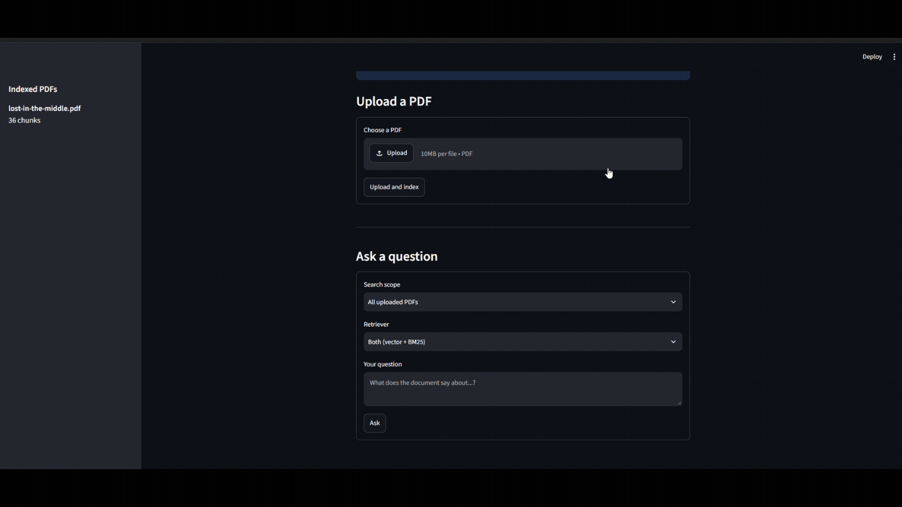
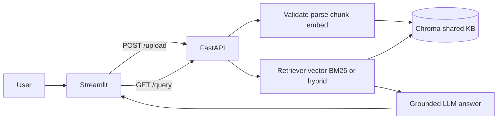

# PDF RAG Assistant

Ask questions about user-uploaded PDFs and get answers grounded in retrieved passages with citations. A Streamlit UI talks to a FastAPI service that validates and indexes PDFs into a shared Chroma collection, retrieves with vector, BM25, or hybrid search, and generates cited answers (or abstains when evidence is weak).

> **Portfolio demo.** Run the app locally with the Quickstart below. This README and [docs/DESIGN.md](docs/DESIGN.md) match the current implementation.

## Live demo



Hosted App/API links are not published yet. Use Quickstart to run Streamlit and FastAPI locally.

## What it does

- Upload and index PDF documents from the Streamlit interface.
- Validate uploads before processing: PDF only, max **10 MB**, max **50 pages**; reject encrypted or corrupt files with a clear error.
- Parse PDFs with Unstructured and Poppler; optional Tesseract OCR for scanned pages.
- Chunk content while preserving citation metadata (`doc_id`, source, page, section).
- Embed chunks with OpenAI and store them in a **shared** Chroma collection.
- Choose retriever mode: **vector**, **BM25**, or **hybrid** (default; EnsembleRetriever weights `0.7` / `0.3`).
- Filter by `doc_id` when querying one PDF, or search the full shared collection.
- Generate cited answers from retrieved excerpts, and abstain when the documents do not support an answer.
- Evaluate behavior with curated questions in `eval/`.

## Example questions

Using a paper such as *Lost in the Middle* (see `eval/documents/`):

- What is the lost-in-the-middle effect?
- Where in the context do models perform best on relevant information?
- What does the paper say about performance when evidence appears in the middle?

## Architecture



Stack: Unstructured and Poppler (optional Tesseract), OpenAI embeddings and chat, Chroma, BM25, LangChain EnsembleRetriever, FastAPI, and Streamlit.

See [docs/DESIGN.md](docs/DESIGN.md) for chunking, retrieval, prompts, and abstention details. See [docs/rag-architecture.png](docs/rag-architecture.png) for a static architecture diagram.

### API shape

`POST /upload` — multipart PDF file.

Success (`201`):

```json
{
  "doc_id": "uuid",
  "filename": "paper.pdf",
  "status": "completed",
  "pages": 12,
  "chunks_stored": 40,
  "error": null
}
```

`GET /query?query=<question>&doc_id=<optional>&retriever=hybrid`

Success:

```json
{
  "answer": "Markdown answer with inline citations such as [S1].",
  "citations": [
    {"id": "S1", "source": "paper.pdf", "page": 7, "section": null}
  ],
  "abstained": false
}
```

When evidence is missing, `abstained` is `true` and `citations` is empty.

Also available: `GET /` (health), `GET /documents`, `GET /documents/{doc_id}`.

## Requirements

- Python 3.12 (see `requires-python` in `pyproject.toml`)
- [`uv`](https://docs.astral.sh/uv/) for the environment
- An OpenAI API key
- Poppler on `PATH`
- Tesseract if OCR for scanned PDFs is enabled
- `libmagic` where required by Unstructured on your platform

## Quickstart

### 1. Clone and install

```powershell
git clone <your-repository-url>
cd rag-assistant
uv sync
```

Poppler, Tesseract, and `libmagic` are system packages; `uv sync` does not install them.

### 2. Configure environment

```powershell
Copy-Item .env.example .env
```

Set at least:

```env
OPENAI_API_KEY=replace-me
OPENAI_CHAT_MODEL=gpt-4o
OPENAI_EMBEDDING_MODEL=text-embedding-3-small
CHROMA_PERSIST_DIRECTORY=./chroma_data
API_BASE_URL=http://127.0.0.1:8000
```

Never commit `.env` or API keys.

### 3. Start the API and UI

```powershell
uv run uvicorn rag_assistant.api:app --reload
```

In another window:

```powershell
uv run streamlit run app/streamlit_app.py
```

Open the Streamlit URL printed in the terminal. FastAPI docs are at `http://127.0.0.1:8000/docs`.

## Safety

- Uploads are validated for type, size, page count, PDF header, and encryption before indexing.
- Temporary upload files are deleted after processing.
- Answers are prompted to use **only** retrieved excerpts; the model is instructed to abstain rather than invent facts or citations.
- The knowledge base is **shared**: any visitor can query documents uploaded by others. There is no per-user isolation or authentication.

## Evaluation

Add representative questions and expected evidence to `eval/questions.json`, then run:

```powershell
uv run python eval/run_eval.py
```

Review answer correctness, citation accuracy, `doc_id` filtering, upload validation, hybrid retrieval on keyword and semantic questions, and abstention when documents do not support an answer.

| Experiment | Notes |
|---|---|
| To be measured | Fill in after running the eval runner against indexed sample PDFs. |

## Project structure

```text
rag-assistant/
|-- src/rag_assistant/
|   |-- config.py          # Settings from .env
|   |-- ingest.py          # Validate, parse, chunk, embed, store PDFs
|   |-- retrieve.py        # Vector, BM25, and hybrid EnsembleRetriever
|   |-- generate.py        # Grounded prompts and cited answers
|   `-- api.py             # FastAPI upload, query, documents routes
|-- app/
|   `-- streamlit_app.py   # UI that calls the FastAPI service
|-- eval/
|   |-- questions.json
|   |-- run_eval.py
|   `-- documents/         # Sample PDFs for evaluation
|-- tests/
|   |-- test_upload.py
|   `-- test_retrieve.py
|-- docs/
|   |-- DESIGN.md          # Current architecture notes
|   |-- rag-architecture.png
|   `-- demo-upload.gif
|-- uploads/               # Runtime temp uploads; do not commit
|-- db_v1/                 # Local Chroma persistence; do not commit secrets
|-- .env.example
|-- CHANGELOG.md
|-- pyproject.toml
|-- uv.lock
|-- LICENSE
`-- README.md
```

## Limitations and future work

- No authentication or private document collections (shared knowledge base).
- No model fine-tuning, web search, document editing, or autonomous tool use.
- Answers may abstain when retrieval does not support a claim.
- Not production-scale infrastructure; focused on RAG, citations, and PDF Q&A.
- Possible later work: hosted Live demo URLs, stronger retention/cleanup for free hosting, and richer eval metrics.

## License

This project is licensed under the MIT License. See [LICENSE](LICENSE). Review licenses for any sample PDFs under `eval/documents/` before redistributing them.

## Acknowledgements

- [LangChain](https://www.langchain.com/)
- [Chroma](https://www.trychroma.com/)
- [Unstructured](https://unstructured.io/)
- [FastAPI](https://fastapi.tiangolo.com/)
- [Streamlit](https://streamlit.io/)
- [OpenAI](https://openai.com/)
