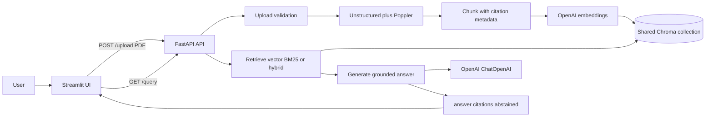

# Architecture

This document describes the **current** PDF RAG Assistant architecture. For setup and run commands, see [README.md](../README.md).

## Overview

The app accepts PDF uploads through Streamlit, validates and indexes them through FastAPI into a **shared Chroma** collection, then answers questions with retrieved chunks and citations. Retrieval can be vector-only, BM25-only, or hybrid (LangChain EnsembleRetriever). The model is instructed to abstain when the supplied excerpts do not support an answer.

The LLM never writes to the vector store directly. The application owns validation, ingestion, retrieval, and response formatting.

## System diagram



## Main components

| Component | Path | Responsibility |
|---|---|---|
| Streamlit UI | `app/streamlit_app.py` | Upload PDFs, choose retriever mode, select document or all docs, show answer and citations. |
| FastAPI API | `src/rag_assistant/api.py` | `POST /upload`, `GET /query`, `GET /documents`, `GET /documents/{doc_id}`, `GET /`. |
| Config | `src/rag_assistant/config.py` | Loads OpenAI and Chroma settings from `.env`. |
| Ingest | `src/rag_assistant/ingest.py` | Parse, chunk, embed, and store PDFs with `doc_id` metadata. |
| Retrieve | `src/rag_assistant/retrieve.py` | Vector, BM25, or hybrid EnsembleRetriever; optional `doc_id` filter; list documents. |
| Generate | `src/rag_assistant/generate.py` | Grounded structured answer with citations and abstention flag. |

## Request flows

### Upload

1. User selects a PDF in Streamlit.
2. Streamlit `POST`s multipart form data to `/upload`.
3. API checks extension, streams to a temp file under `uploads/tmp`, enforces **10 MB** max size, `%PDF-` header, not encrypted, and **50** pages max.
4. `Ingest` parses (Unstructured/Poppler; OCR when enabled), chunks with citation metadata, embeds, and writes to the shared Chroma collection.
5. API returns `doc_id`, filename, status, pages, and `chunks_stored`, then deletes the temp file.

### Query

1. User asks a question, optionally selects one `doc_id`, and chooses `vector` / `bm25` / `hybrid`.
2. Streamlit calls `GET /query` with query parameters.
3. `Retrieve` fetches about top-k chunks (hybrid uses EnsembleRetriever weights `[0.7, 0.3]`, vector then BM25).
4. `Generate` builds a grounded prompt from those chunks and returns `{ answer, citations, abstained }`.
5. Streamlit renders the answer and citation list.

## API request and response shape

**Upload:** `POST /upload` (multipart file)

```json
{
  "doc_id": "uuid",
  "filename": "paper.pdf",
  "status": "completed",
  "pages": 12,
  "chunks_stored": 40,
  "error": null
}
```

**Query:** `GET /query?query=...&doc_id=...&retriever=hybrid`

```json
{
  "answer": "Markdown answer with inline citations such as [S1].",
  "citations": [
    {"id": "S1", "source": "paper.pdf", "page": 7, "section": null}
  ],
  "abstained": false
}
```

**Document status:** `GET /documents/{doc_id}` returns the in-memory status record (`DocumentStatusResponse`).  
**List:** `GET /documents` returns indexed documents from retrieval.  
**Health:** `GET /` returns `{ "message": "RAG assistant API is running" }`.

## Chunking and retrieval (current choices)

- Target chunking guidance: about **3000 tokens** with **500** overlap where practical; preserve page/section boundaries.
- Unstructured `chunk_by_title` character settings are **not** the same as tokens; do not treat `max_characters=3000` as 3000 tokens.
- Same OpenAI embedding model for documents and queries.
- Hybrid default: EnsembleRetriever `weights=[0.7, 0.3]` (vector, BM25).
- Pass about **top-k = 5** chunks into the answer step as an initial setting.
- Citation metadata on chunks: `doc_id`, source/filename, page, section when available.

## Safety boundaries

- Shared knowledge base: any visitor can query uploads from others; no auth or private collections.
- Validate PDF type, size, page count, header, and encryption before indexing.
- Remove temporary upload files after processing.
- Prompt the model to use only supplied excerpts, cite with labels like `[S1]`, and abstain when evidence is missing.
- Do not invent page numbers, sections, or document names in citations.

Document removal by `doc_id` (Chroma vectors and any retained original PDF) should stay explicit in the product UX when those controls are exposed.

## Project structure

```text
rag-assistant/
|-- src/rag_assistant/
|   |-- config.py
|   |-- ingest.py
|   |-- retrieve.py
|   |-- generate.py
|   `-- api.py
|-- app/
|   `-- streamlit_app.py
|-- eval/
|   |-- questions.json
|   |-- run_eval.py
|   `-- documents/
|-- tests/
|-- docs/
|   |-- DESIGN.md
|   |-- rag-architecture.png
|   `-- demo-upload.gif
|-- uploads/               # Runtime; do not commit
|-- .env.example
|-- CHANGELOG.md
|-- pyproject.toml
|-- uv.lock
|-- LICENSE
`-- README.md
```

## Scope and known gaps

- Portfolio demo focused on RAG, citations, and PDF Q&A—not production multi-tenant hosting.
- No authentication, private collections, fine-tuning, web search, or agent tool use.
- Upload status lives partly in an in-memory map (`DOCUMENT_STATUS_DB`); process restarts lose that status view even if Chroma persists.
- Evaluation harness exists; published metric tables are still to be filled after runs.

Possible later work: managed vector store, stronger retention/cleanup, richer eval metrics, and optional private per-session collections.
